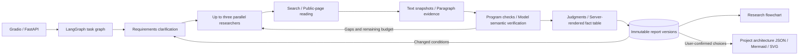

# Technology selection research agent

English · [简体中文](README.md)

An evidence research workbench for individual developers. It clarifies requirements, researches candidate products in parallel, reads original sources, checks claims, and investigates gaps before publishing a comparison report. Source facts and conditional judgments are separate, and reports retain unknowns and conflicts.

The current version is **v0.1.0**, including research flowcharts and versioned project architectures. The default fixture demo needs no API keys. Fixture results verify program mechanisms; the complete live workflow has not passed validation after the latest verification checks were added.

## Features and research scope

- Collect deployment requirements, existing technology, and preferences before asking for missing conditions; users can explicitly allow unknown conditions.
- Run up to three product researchers in parallel, preserving original source snapshots, hashes, and paragraph evidence.
- Combine program checks with model semantic verification to distinguish supported, contradicted, and insufficient claims; investigate gaps within a budget.
- Reuse valid evidence within the same session when conditions change, publish an immutable report version, and retain historical viewing and Markdown export.
- Generate structured research flowcharts and Mermaid from stored task records without additional model or search calls.
- Create project technology layers from preset or user-supplied catalogs, research each layer, and publish versioned JSON, Mermaid, and SVG architectures after user confirmation.

The built-in research catalogs are:

| Category | Candidate products |
| --- | --- |
| Vector databases | pgvector, Qdrant, Milvus |
| Search APIs | Tavily, Exa, Brave Search API |
| RAG platforms | Dify, FastGPT, RAGFlow |

These products are research subjects; installing all nine is unnecessary. The catalog does not establish performance benchmarks, compatibility tests, or automatic candidate discovery for arbitrary goals.

## Stack and architecture

| Layer | Implementation |
| --- | --- |
| Runtime | Python 3.11/3.12, uv |
| Workbench and API | Gradio, FastAPI, Uvicorn |
| Task orchestration and models | LangGraph, OpenAI-compatible endpoint, native tool_calls |
| Live sources | Tavily search, HTTPX public-page reader, Beautiful Soup, pypdf |
| Persistence | SQLite WAL, text snapshots, paragraph evidence, immutable report versions |
| Graph output | Structured graphs, Mermaid, deterministic project architecture SVG |



## Quickstart: fixture demo

Install Git, uv, and Python 3.11. On Windows, run the commands in PowerShell 7 (`pwsh`). The project supports Python `>=3.11,<3.13`; these commands use the 3.11 environment documented in validation records.

```powershell
git clone https://github.com/haihaihai112/tech-selection-agent.git
cd tech-selection-agent
uv sync --frozen --python 3.11
uv run --no-sync selection --fixture
```

Open the [workbench](http://127.0.0.1:8050/ui/) or [API documentation](http://127.0.0.1:8050/docs). Stop with Ctrl+C. For a port conflict, run `uv run --no-sync selection --fixture --port 8150`. The repository also includes `scripts/start.ps1` and `sh scripts/start.sh`.

Fixture mode uses deterministic model decisions and synthetic upstream material, with synthetic labels retained in the UI. LangGraph, tool scheduling, evidence storage, verification checks, report versions, the database, and HTTP interfaces run normally. Synthetic reports do not establish real product capabilities.

### Walkthrough

The workbench and fixture examples use Chinese prompts:

1. Select `向量数据库` and enter `为个人知识库比较三款向量数据库，优先考虑维护成本`.
2. Answer deployment and technology questions with `本地部署，其他条件暂不确定`, allow missing conditions, and submit.
3. Inspect the comparison, unknowns, and original evidence. Confirm that fixture labels remain visible.
4. Enter `我已经使用PostgreSQL` in the revision area to generate version 2 and inspect changed conditions and evidence reuse.
5. Export version 1, record the task ID, and recover it after restarting.
6. Inspect a task or report flowchart. A project architecture requires creating layers, researching them, and explicitly confirming selections.

The UI polls for business state and does not expose model chain of thought. Data defaults to `runtime/`; set `SELECTION_RUNTIME` to use another directory.

## Live models and source services

Copy the example configuration and supply your provider endpoint, a model with native tool calling, and credentials:

```powershell
Copy-Item .env.example .env
```

```dotenv
AGENT_MODE=live
LLM_API_KEY=your-provider-key
LLM_MODEL=your-tool-calling-model
LLM_BASE_URL=https://your-provider.example/v1
TAVILY_API_KEY=your-tavily-key
```

The example's default model and endpoint do not guarantee access under your plan or available quota. Use `cp .env.example .env` in Bash. After configuration, run the preflight and start the service:

```powershell
uv run --no-sync python scripts/check_live.py
$env:AGENT_MODE = 'live'
uv run --no-sync selection
```

In Bash, set `export AGENT_MODE=live`. Preflight performs a model tool call, a Tavily search, and an original-page read, consuming service quota. `ready_for_demo` means preflight passed; it does not validate a complete research task. Keep credentials out of conversations, reports, and Git.

`LLM_FALLBACK_MODELS` accepts alternatives supported by the same provider. Switching occurs only for explicit quota exhaustion errors, not authentication failures, ordinary rate limits, or parameter errors. Records preserve requested/response models, tokens, and switching reasons. Mixed-model runs do not reuse the primary model's pricing estimate.

Default budgets allow 18 searches, 24 page reads, two targeted repair rounds, and up to 8 model decision rounds per product. Active processing is limited to 300 seconds, excluding time waiting for user answers. Readers support public HTML, text, and text-layer PDFs; OCR, browser rendering, and login bypass are absent.

## Flowcharts and project architectures

```text
GET /v1/tasks/{task_id}/flowchart
GET /v1/reports/{report_id}/flowchart?version=N
POST /v1/projects
POST /v1/projects/{id}/layers/{layer}/research
POST /v1/projects/{id}/confirm
GET /v1/projects/{id}/architecture?version=N
```

Research flowcharts use saved tasks, evidence, and reports, retaining failed, partial, and waiting-for-input states. Project confirmation must reference candidates, supported facts, and explicit versions from published reports. Recommendations do not automatically become adopted components. Architecture edges describe user-confirmed design relationships, not tested product compatibility. See [interfaces](docs/INTERFACES.md) for request schemas.

## Checks and validation records

```powershell
uv run --no-sync pytest -q --junitxml=reports/tests-local.xml
uv run --no-sync ruff check src tests scripts
uv run --no-sync python scripts/evaluate.py --ablation --output reports/development-local.json
```

Keep a fixture service running and replay the HTTP demo in another terminal:

```powershell
uv run --no-sync python scripts/smoke.py --base http://127.0.0.1:8050 --output reports/http-smoke-local.json
```

The [validation record](reports/VALIDATION.md) documents 61 automated tests and HTTP/Gradio callback checks on 2026-10-13. Historical development mechanism scenarios passed 30/30; the first holdout run passed 12/15, with failures retained in the [holdout results](reports/holdout.json). These fixture numbers do not measure live model accuracy. The holdout record is also not an independent blind evaluation of the final version.

[Publication checks](docs/PUBLICATION.md) on 2026-10-14 passed 61 pytest tests and Ruff, with HTTP 200 from the workbench and API documentation. The [new fixture smoke record](reports/publication-smoke.json) passed initial research, revision to version 2, evidence retrieval, and report export. It does not verify upstream connectivity or model quality.

An earlier live run produced two `partial` reports; see the [historical live trace](reports/live-demo-final-deepseek.json). After recommendation-reason verification was added, the [audited live run](reports/live-demo-audited.json) failed in the Writer stage and published no report. The current complete live workflow still requires validation.

## Scope and limitations

- Deploy locally for a single user and service process. There is no public identity system or distributed task queue; multiple workers must not share task writes.
- Reachable sources, preserved text, and model judgments do not guarantee real-world correctness. Requirements, judgments, and recommendations require human review.
- Document size, page, character, and paragraph limits can omit information. Reports must retain gaps rather than claim exhaustive coverage.
- The nine research products have not been deployed for performance benchmarks. All live conclusions and provider prices/plans have not been independently reviewed; no real selection success rate is claimed.
- Flowcharts and architectures are deterministic outputs without ComfyUI or paid image APIs. Docker has configuration checks only; container execution remains unverified.

## Documentation, attribution, and license

- [Interfaces and data semantics](docs/INTERFACES.md): API, evidence scope, recovery, caching, and costs.
- [Delivery stages and checks](docs/DELIVERY_STAGES.md): mechanism and live validation scope.
- [Validation record](reports/VALIDATION.md), [assistant review](reports/ASSISTANT_REVIEW.md), and [human review template](reports/human-review-template.csv): results, failures, and pending review.
- [Project architecture design](docs/superpowers/specs/2026-10-13-flowchart-design.md): catalog, confirmation, and graph boundaries.

This project derives from the original `enterprise-intelligence-agent`, reusing and adapting Qwen-compatible calls, Tavily search, parallel research, and per-task locked usage accounting. Logistics evaluations and metrics from that baseline do not establish this project's effectiveness.

The repository currently has no LICENSE file or declared repository-wide open-source license. Public availability does not automatically grant rights to use, modify, or redistribute the code. Dependencies and retrieved materials retain their own licenses and terms.
