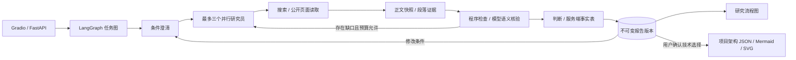

# 技术选型研究 Agent

[English](README.en.md) · 简体中文

面向个人开发者的证据研究工作台：澄清用户条件，并行研究候选产品，读取原文、核验结论、补查缺口，生成可追溯、可修订的比较报告。来源事实与条件式判断分开呈现，未知项和冲突保留在报告中。

当前版本为 **v0.1.0**，包含研究流程图和项目架构版本功能。默认 fixture 演示无需 API 密钥。fixture 通过情况只验证程序机制；新增核验门禁后的完整在线研究流程尚未验证通过。

## 功能与研究范围

- 先整理部署环境、已有技术栈和偏好，再追问缺失条件；用户可明确允许部分条件未知。
- 最多三个产品研究员并行搜索与读取公开原文，保存来源快照、内容哈希和段落证据。
- 结合程序检查和模型语义核验，区分支持、矛盾和证据不足，在预算内定向补查。
- 修改条件后复用同一会话内仍有效的证据，生成不可变的新报告版本，保留旧版查看和 Markdown 导出。
- 根据持久化任务记录生成结构化研究流程图与 Mermaid，不触发额外模型或搜索调用。
- 从预设或用户自定义目录创建项目技术层，逐层研究后由用户确认，输出版本化 JSON、Mermaid 和 SVG 架构图。

内置研究目录为：

| 类别 | 候选产品 |
| --- | --- |
| 向量数据库 | pgvector、Qdrant、Milvus |
| 搜索 API | Tavily、Exa、Brave Search API |
| RAG 平台 | Dify、FastGPT、RAGFlow |

这些产品是研究对象，无需安装九款产品。目录不代表已完成性能基准、兼容性测试或针对任意目标自动发现候选技术。

## 技术与架构

| 层 | 实现 |
| --- | --- |
| 运行环境 | Python 3.11/3.12、uv |
| 工作台与 API | Gradio、FastAPI、Uvicorn |
| 任务编排与模型 | LangGraph、OpenAI 兼容接口、原生 tool_calls |
| 在线资料 | Tavily 搜索、HTTPX 公开页面读取、Beautiful Soup、pypdf |
| 持久化 | SQLite WAL、正文快照、段落证据、不可变报告版本 |
| 图形输出 | 结构化图、Mermaid、确定性 SVG 项目架构 |



## 快速启动：fixture 演示

准备 Git、uv 和 Python 3.11；Windows 请使用 PowerShell 7（`pwsh`）执行本文命令。项目支持 Python `>=3.11,<3.13`，下面使用验证记录中的 3.11 环境。

```powershell
git clone https://github.com/haihaihai112/tech-selection-agent.git
cd tech-selection-agent
uv sync --frozen --python 3.11
uv run --no-sync selection --fixture
```

打开[工作台](http://127.0.0.1:8050/ui/)或 [API 文档](http://127.0.0.1:8050/docs)，按 Ctrl+C 停止。端口冲突时运行 `uv run --no-sync selection --fixture --port 8150`。也可使用 `scripts/start.ps1` 或 `sh scripts/start.sh`。

fixture 使用确定性模型决策与合成上游资料，页面保留合成标识。LangGraph、工具调度、证据存储、核验门禁、报告版本、数据库和 HTTP 接口实际执行；合成报告不能作为真实产品能力结论。

### 演示流程

1. 选择“向量数据库”，输入“为个人知识库比较三款向量数据库，优先考虑维护成本”。
2. 系统追问部署与技术栈。回复“本地部署，其他条件暂不确定”，勾选允许缺少部分条件，提交补充条件。
3. 查看比较报告、未知项和原文证据，确认测试模式标识仍在。
4. 在修改条件区输入“我已经使用PostgreSQL”，生成第二版，查看条件变化和证据复用。
5. 选择版本 1 导出旧版，记录任务编号，重启后恢复查看。
6. 查看任务或报告的流程图；项目架构则需要创建技术层、逐层研究并显式确认选择。

工作台使用轮询显示业务状态，不展示模型内部思维链。默认运行数据保存在 `runtime/`，可通过 `SELECTION_RUNTIME` 指定其他目录。

## 在线模型与资料服务

复制示例配置后，填写本人可用的服务商地址、支持原生工具调用的模型和密钥：

```powershell
Copy-Item .env.example .env
```

```dotenv
AGENT_MODE=live
LLM_API_KEY=your-provider-key
LLM_MODEL=your-tool-calling-model
LLM_BASE_URL=https://your-provider.example/v1
TAVILY_API_KEY=your-tavily-key
```

示例中的默认模型和地址不保证属于你的套餐，也不保证有可用额度。Bash 可用 `cp .env.example .env`。配置完成后，先预检，再启动：

```powershell
uv run --no-sync python scripts/check_live.py
$env:AGENT_MODE = 'live'
uv run --no-sync selection
```

Bash 设置环境变量的写法为 `export AGENT_MODE=live`。预检会调用一次模型工具调用、一次 Tavily 搜索及一次原文读取，会消耗服务额度；`ready_for_demo` 只表示预检成功，不代表完整研究流程通过。密钥不要放进对话、报告或 Git。

`LLM_FALLBACK_MODELS` 可配置同一服务商的备用模型。系统只在明确的配额耗尽错误时切换；认证失败、普通限流和参数错误不触发切换。请求记录保留请求/响应模型、Token 与原因；混用模型时不沿用主模型单价估算费用。

默认预算为 18 次搜索、24 次页面读取、两轮定向补查、每产品最多 8 轮模型决策。任务主动处理上限 300 秒，等待用户回答不计入。支持公开 HTML、文本和文本型 PDF；不包含 OCR、浏览器渲染或登录绕过。

## 流程图与项目架构

```text
GET /v1/tasks/{task_id}/flowchart
GET /v1/reports/{report_id}/flowchart?version=N
POST /v1/projects
POST /v1/projects/{id}/layers/{layer}/research
POST /v1/projects/{id}/confirm
GET /v1/projects/{id}/architecture?version=N
```

研究流程图来自已保存的任务、证据和报告，保留失败、部分完成和等待输入状态。项目确认必须引用已发布报告中的候选、支持事实和具体版本；系统不会把推荐自动当作已采用组件。架构连线表示用户确认的设计关系，不证明产品兼容性经过实测。详细请求结构见[接口说明](docs/INTERFACES.md)。

## 检查与验证记录

```powershell
uv run --no-sync pytest -q --junitxml=reports/tests-local.xml
uv run --no-sync ruff check src tests scripts
uv run --no-sync python scripts/evaluate.py --ablation --output reports/development-local.json
```

保持 fixture 服务运行，在另一终端执行 HTTP 演示重放：

```powershell
uv run --no-sync python scripts/smoke.py --base http://127.0.0.1:8050 --output reports/http-smoke-local.json
```

[验证记录](reports/VALIDATION.md)包含 2026-10-13 的 61 项自动测试、HTTP 和 Gradio 回调检查。历史开发机制场景为 30/30；留出场景首次为 12/15，失败样本保存在[留出结果](reports/holdout.json)。这些数字来自 fixture，不能换算为真实模型准确率；留出结果也不是最终版本的独立盲评。

2026-10-14 [发布前复核](docs/PUBLICATION.md)：61 项 pytest 与 Ruff 通过，工作台和 API 文档返回 HTTP 200；[本次 fixture 冒烟](reports/publication-smoke.json)通过首版研究、条件修订到版本 2、证据读取和报告导出，未验证上游在线连通或模型效果。

较早在线运行产出过两版 `partial` 报告，见[历史在线轨迹](reports/live-demo-final-deepseek.json)。新增推荐理由核验后，[在线审计运行](reports/live-demo-audited.json)在 Writer 阶段失败且没有发布报告；当前完整在线闭环仍需验证。

## 范围与限制

- 本地单用户、单服务进程；没有公网身份系统或分布式任务队列，不支持多个 worker 共写任务库。
- 来源可访问、原文存在和语义模型判定都不能保证现实事实正确。用户条件、判断和建议仍需人工审阅。
- 读取有文档大小、页数、字符数和段落数限制，可能遗漏信息；缺口应保留，不能据此声称穷尽全部资料。
- 未部署九款研究产品进行性能基准，未独立审阅全部在线结论，也未验证所有价格或套餐；没有真实选型成功率声明。
- 流程图和项目架构为确定性输出，未接入 ComfyUI 或付费图像 API。Docker 仅有配置检查记录，尚未验证容器运行。

## 文档、来源与许可

- [接口与数据语义](docs/INTERFACES.md)：API、证据范围、恢复、缓存和费用。
- [交付阶段与复核命令](docs/DELIVERY_STAGES.md)：机制与在线验证范围。
- [验证记录](reports/VALIDATION.md)、[助手复核](reports/ASSISTANT_REVIEW.md)和[人工审阅模板](reports/human-review-template.csv)：已有结果、失败与待复核项。
- [项目架构设计](docs/superpowers/specs/2026-10-13-flowchart-design.md)：候选目录、确认和图形边界。

项目以原 `enterprise-intelligence-agent` 为基线，复用并改造了 Qwen 兼容调用、Tavily 搜索、并行研究和单任务加锁用量统计的实现。原基线的物流评测和指标不用于本项目效果声明。

仓库目前未附带 LICENSE，也未声明统一的开源许可。公开代码不自动授予使用、修改或再分发权；第三方依赖和抓取资料仍适用各自的许可与使用条款。
